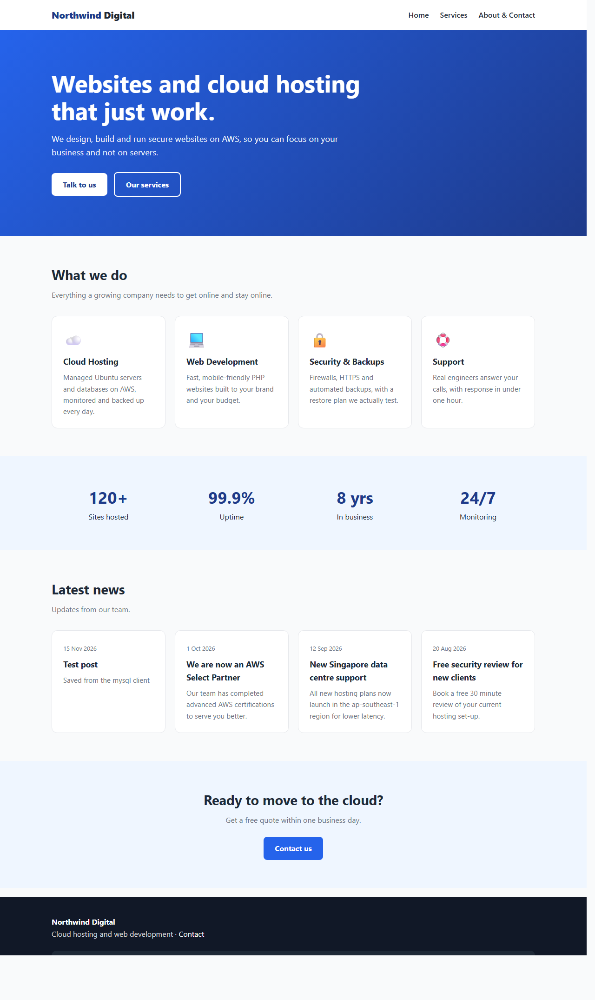
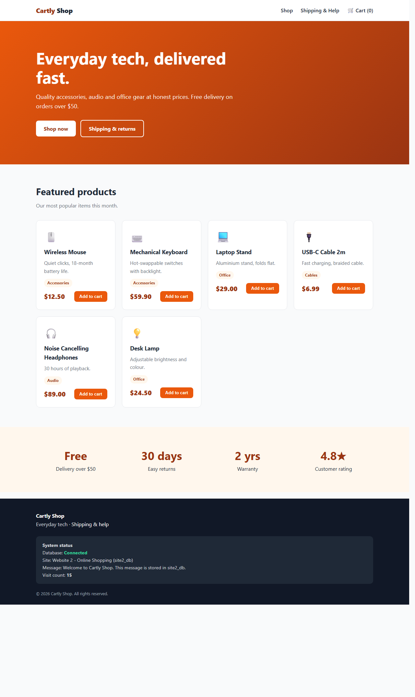
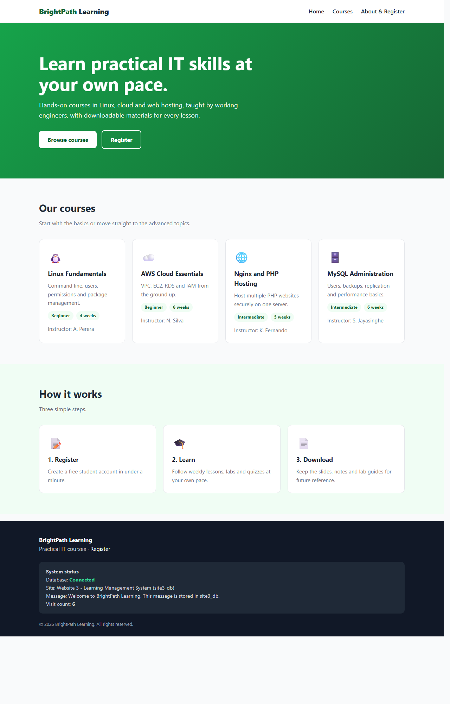

# SysOps Practical Exam: Three PHP Websites on AWS

Hosts three PHP websites on **one Ubuntu server** (Nginx + PHP 8.3-FPM), each with its own database on a **private Amazon RDS MySQL** instance. The network, security groups, EC2 instance and RDS database are built with Terraform. The web server is configured by hand.

| | |
|---|---|
| Candidate | Nimesha Yasith |
| Region | `ap-southeast-1` (Singapore) |
| Web server | `sysops-nimesha-web01`, Elastic IP `47.130.163.143` |
| Database | `sysops-nimesha-db` (MySQL 8.0, `db.t3.micro`, single-AZ, private) |
| Tags on all resources | `Project = SysOpsTest`, `Owner = Nimesha Yasith` |

---

## 1. Architecture

```
 Visitors ──HTTP/HTTPS──▶ Internet Gateway
                                │
 ┌──────────── VPC sysops-nimesha-vpc 10.10.0.0/16 ───────────────────┐
 │  AZ ap-southeast-1a                      AZ ap-southeast-1b        │
 │  ┌─ Public subnet A 10.10.1.0/24 ─┐      ┌─ Public subnet B ─────┐  │
 │  │ EC2 t3.micro, Ubuntu 24.04     │      │ 10.10.2.0/24 (spare)  │  │
 │  │ Nginx + PHP 8.3-FPM            │      └───────────────────────┘  │
 │  │ website1 | website2 | website3 │                                 │
 │  │ web-sg: 80,443 any; 22 my IP   │                                 │
 │  └──────────────┬─────────────────┘                                 │
 │                 │ MySQL 3306 (db-sg: from web-sg only)              │
 │  ┌─ Private subnet A 10.10.11.0/24 ┐     ┌─ Private subnet B ────┐  │
 │  │ RDS MySQL 8.0 db.t3.micro       │     │ 10.10.12.0/24 (DB     │  │
 │  │ site1_db | site2_db | site3_db  │     │ subnet group only)    │  │
 │  └─────────────────────────────────┘     └───────────────────────┘  │
 └─────────────────────────────────────────────────────────────────────┘
```

Only the web server is reachable from the internet. The database accepts traffic from the web server's security group and nothing else.

## 2. What was built

### Network (Task 1)
| Resource | Value |
|---|---|
| VPC | `sysops-nimesha-vpc`, `10.10.0.0/16`, DNS support and hostnames on (default VPC not used) |
| Public subnets | `10.10.1.0/24` (1a), `10.10.2.0/24` (1b), auto-assign public IPv4 on |
| Private subnets | `10.10.11.0/24` (1a), `10.10.12.0/24` (1b) |
| Internet gateway | attached to the VPC |
| Public route table | `0.0.0.0/0` to the IGW, associated with both public subnets |
| Private route table | local route only, associated with both private subnets |
| NAT gateway | none |

### Security groups (Task 2)
| Group | Inbound |
|---|---|
| `sysops-nimesha-web-sg` | TCP 80 and 443 from `0.0.0.0/0`; TCP 22 from the administrator's single IP (`/32`) |
| `sysops-nimesha-db-sg` | TCP 3306 from `sysops-nimesha-web-sg` only (referenced by security group, not CIDR) |

The web group also has an allow-all outbound rule, needed for `apt` and for the connection to RDS.

### EC2 web server (Task 3)
Ubuntu Server 24.04 LTS, `t3.micro`, public subnet A, new key pair, 20 GiB encrypted `gp3` root volume, IMDSv2 required, Elastic IP attached, hostname `sysops-web01`, timezone `Asia/Colombo`.

### Web stack (Task 4)
Nginx, `php8.3-fpm`, `php8.3-mysql`, `php8.3-cli`, `php8.3-mbstring`, `php8.3-xml` and `mysql-client`. Nginx passes PHP to PHP-FPM over the Unix socket `/run/php/php8.3-fpm.sock`. Hardening: `server_tokens off;` in Nginx and `expose_php = Off` in PHP.

### RDS database (Task 5)
MySQL 8.0, `db.t3.micro`, single-AZ, 20 GiB encrypted `gp3`, public access **No**, security group `db-sg` only, automated backups on with 1-day retention, deletion protection off (so the evaluator can remove it).

### Databases and users (Task 6)
`db/setup.sql` creates `site1_db`, `site2_db`, `site3_db` and one user per database. Each user has privileges on its own database only.

### Virtual hosts (Task 7)
| Domain | Document root | Database |
|---|---|---|
| `website1.saberion.cloud` | `/var/www/website1.saberion.cloud/public` | `site1_db` |
| `website2.saberion.cloud` | `/var/www/website2.saberion.cloud/public` | `site2_db` |
| `website3.saberion.cloud` | `/var/www/website3.saberion.cloud/public` | `site3_db` |

One server block per site in `sites-available/`, enabled by symlink; default site removed; separate access and error logs per site; `config.php` sits one level above `public/`, owned `root:www-data` with mode `640`. A `default_server` block returns `444` for the bare IP and unknown host names. `deploy/setup-vhosts.sh` creates all of this.

### Websites (Task 8)
| Site | Theme | Dynamic content (from its own database) |
|---|---|---|
| Website 1: Northwind Digital | Company website | News items |
| Website 2: Cartly Shop | Online shop | Products, **cart and checkout** (`cart_items`, `orders`, `order_items`) |
| Website 3: BrightPath Learning | Learning management system | Courses |

Every site has a dynamic `index.php` (the default page) and a static `about.html`. The footer **System status** panel on each home page shows **Connected**, the site name, the message stored in the site's own database, and a visit counter that rises on each refresh. Tables are created and seeded automatically on the first visit. Database passwords live only in each site's `config.php` on the server.

## 3. Repository layout

```text
.
├── main.tf  variables.tf  outputs.tf  versions.tf   # Terraform root
├── modules/{network,security,compute,database}/     # Terraform modules
├── db/setup.sql                                     # databases and users (placeholder passwords)
├── sites/website{1,2,3}.saberion.cloud/             # PHP sites
│   ├── config.php                                   # DB settings (outside public/)
│   ├── includes/                                    # DB logic, shared layout (outside public/)
│   └── public/                                      # index.php, about.html, assets/style.css
├── deploy/                                          # setup-vhosts.sh, build-css.sh, CSS template
└── docs/                                            # screenshots, evidence, Overleaf source
```

## 4. Deploy

```bash
# 1. Infrastructure (from the project root)
export TF_VAR_db_password='<strong password, 12-41 chars, no @ / " or spaces>'
terraform init
terraform plan
terraform apply

# 2. Databases (on the server, after copying db/setup.sql and editing its passwords)
mysql -h <rds-endpoint> -u sysopsadmin -p < ~/setup.sql

# 3. Sites (copy, then set each config.php password on the server)
scp -i <key>.pem -r sites deploy ubuntu@<elastic-ip>:~/
sudo cp -r ~/sites/* /var/www/
sudo chown -R www-data:www-data /var/www/website*.saberion.cloud
sudo chown root:www-data /var/www/website*.saberion.cloud/config.php
sudo chmod 640 /var/www/website*.saberion.cloud/config.php

# 4. Nginx virtual hosts
sudo bash ~/deploy/setup-vhosts.sh
```

The RDS password is supplied through `TF_VAR_db_password` and is never written to a website file. The `terraform.tfvars`, state files and `.pem` key are excluded from Git.

## 5. Verification and evidence

Collected on 2026-11-16 with the AWS CLI and `curl`/Chrome against the Elastic IP. Raw output is in [`docs/evidence/`](docs/evidence/).

### Infrastructure (AWS CLI, [aws-resources.txt](docs/evidence/aws-resources.txt))

| Check | Result |
|---|---|
| EC2 type, AZ, subnet | `t3.micro`, `ap-southeast-1a`, public subnet A |
| IMDSv2 | `required` |
| Root volume | 20 GiB, `gp3`, encrypted |
| Elastic IP | `47.130.163.143` attached to the instance |
| Security groups on instance | `sysops-nimesha-web-sg` |
| Subnet CIDRs and public IP setting | all four match; public subnets auto-assign, private do not |
| NAT gateways | none |
| Private route table | local route only, 2 subnet associations |
| Public route table | `0.0.0.0/0` to IGW, 2 subnet associations |
| `db-sg` inbound | 3306 from `web-sg` only |
| RDS | MySQL `8.0.46`, `db.t3.micro`, single-AZ, 20 GiB `gp3`, encrypted, not public, 1-day backups, deletion protection off, status `available` |
| Tags | `Project = SysOpsTest`, `Owner = Nimesha Yasith`, names start with `sysops-nimesha-` |

### Web behaviour (`curl`, [http-checks.txt](docs/evidence/http-checks.txt))

| Check | Expected | Result |
|---|---|---|
| Request to bare IP | no site shown | connection closed, no reply (`444`) |
| Unknown host name | no site shown | connection closed, no reply (`444`) |
| `/config.php` on each site | not downloadable | `404` for all three |
| Response header | no version | `Server: nginx` (no version, no `X-Powered-By`) |
| Each home page | Connected, site name, own message | all three pass |
| Refresh visit count | increases | website3: 8 then 9 |

### Screenshots

| Website 1 | Website 2 | Website 3 |
|---|---|---|
|  |  |  |

Static page and cart: [`website1-about.png`](docs/screenshots/website1-about.png), [`website2-cart.png`](docs/screenshots/website2-cart.png).

### Still to capture on the server (run and paste into your work log)

```bash
nginx -v; php -v
systemctl is-enabled nginx php8.3-fpm
sudo nginx -t
hostnamectl | grep -i "static hostname"; timedatectl | grep "Time zone"
ls -l /var/www/website*.saberion.cloud/config.php
mysql --no-defaults -h <rds-endpoint> -u site1_user -p -e "USE site2_db"   # must fail: Access denied
```

## 6. Command reference (every command used, and why)

This project was also a learning exercise, so this section lists the commands used, grouped by tool, with what each one does and the reason it was needed. Where a command is run decides which machine it must be typed on:

- **LAPTOP** = Git Bash on the Windows laptop, in the project folder.
- **SERVER** = the EC2 instance, after connecting with SSH.

Placeholders in angle brackets, such as `<rds-endpoint>`, are replaced with real values. **No password is ever typed inside a command.** Commands that need one use `-p`, which asks for it with hidden input.

### 6.1 Terraform (LAPTOP): builds the AWS infrastructure from code

| Command | What it does | Why |
|---|---|---|
| `export TF_VAR_db_password='...'` | Stores the RDS master password in an environment variable for this terminal session only | Terraform reads variables named `TF_VAR_<name>`, so the password never sits in a file. No spaces around `=`, and single quotes keep special characters safe |
| `terraform init` | Downloads the AWS provider plugin and prepares the folder | Must be run once before anything else |
| `terraform fmt -recursive` | Reformats all `.tf` files, including the modules | Keeps the code tidy and consistent |
| `terraform validate` | Checks the code for syntax and reference errors, without touching AWS | Finds mistakes before any change is made |
| `terraform plan` | Compares the code with what exists in AWS and lists what would be added, changed or destroyed | A safe preview. Always read it before applying |
| `terraform apply` | Makes the changes shown in the plan, after you type `yes` | Creates or updates the real AWS resources |
| `terraform apply -replace="module.database.aws_db_instance.this"` | Forces one named resource to be destroyed and created again | Used to rebuild the RDS instance under its new name |
| `terraform output` | Prints the output values (Elastic IP, endpoint, IDs) | Gets the values needed for SSH and the database connection |
| `terraform plan -no-color \| grep -E "will be destroyed\|must be replaced"` | Shows only the resources the plan would destroy or replace | A safety check that the EC2 server, VPC and Elastic IP were not about to be deleted |

### 6.2 Git (LAPTOP): version control

| Command | What it does |
|---|---|
| `git status --short` | Lists changed and untracked files in short form |
| `git diff --stat` | Summarises how many lines changed in each file |
| `git add <files>` | Chooses which files go into the next commit |
| `git commit -m "..."` | Saves the chosen changes as one commit |
| `git log --oneline -1` | Shows the latest commit on one line |

`terraform.tfvars`, the state files and the `.pem` key are listed in `.gitignore`, so they are never committed.

### 6.3 Connecting to the server (LAPTOP)

| Command | What it does | Why |
|---|---|---|
| `ssh -i Saberian_new.pem ubuntu@<elastic-ip>` | Opens a secure shell on the server, logging in as `ubuntu` with the private key | The only way to administer the server. Port 22 is open only to my IP |
| `chmod 400 Saberian_new.pem` | Makes the key readable by its owner only | SSH refuses a key that other users can read |
| `scp -i Saberian_new.pem db/setup.sql ubuntu@<elastic-ip>:~/` | Copies one file to the server's home folder | Moves `setup.sql` to the server, because the database is only reachable from there |
| `scp -i Saberian_new.pem -r sites deploy ubuntu@<elastic-ip>:~/` | Copies whole folders (`-r` = recursive) | Uploads the websites and deploy scripts |
| `curl -4 https://checkip.amazonaws.com` | Prints my public IPv4 address | Needed for the SSH rule in `web-sg` |
| `exit` | Closes the SSH session and returns to the laptop | |

### 6.4 Preparing the server (SERVER)

| Command | What it does | Why |
|---|---|---|
| `sudo apt update` | Refreshes the list of available packages | Run before installing anything |
| `sudo apt upgrade` | Installs available updates | Task 4 requires an updated server |
| `sudo apt install -y nginx php8.3-fpm php8.3-mysql php8.3-cli php8.3-mbstring php8.3-xml mysql-client` | Installs the web stack (`-y` answers "yes" automatically) | Nginx serves pages, PHP-FPM runs PHP, `php8.3-mysql` lets PHP talk to MySQL, and `mysql-client` provides the `mysql` command |
| `sudo apt install -y tree` and `tree` | Installs and runs a folder-tree viewer | Shows the layout of `/var/www` |
| `sudo hostnamectl set-hostname sysops-web01` | Sets the server's hostname | Task 3 |
| `sudo timedatectl set-timezone Asia/Colombo` | Sets the timezone | Task 3 |
| `hostnamectl` and `timedatectl` | Show the current hostname and timezone | Verify the two settings above |

### 6.5 Nginx and PHP (SERVER)

| Command | What it does | Why |
|---|---|---|
| `nginx -v` and `php -v` | Print the installed versions | Evidence for the work log (Task 4) |
| `sudo nginx -t` | Tests the Nginx configuration without applying it | Catches typos before they take the site down. Must say "test is successful" |
| `sudo systemctl reload nginx` | Applies new Nginx settings without dropping connections | Used after editing the virtual hosts |
| `sudo systemctl restart php8.3-fpm` | Restarts PHP-FPM | Needed after changing `php.ini` |
| `systemctl is-enabled nginx php8.3-fpm` | Shows whether each service starts at boot | Task 4 requirement ("enabled") |
| `systemctl is-active nginx php8.3-fpm` | Shows whether each service is running now | |
| `sudo sed -i 's/^expose_php = .*/expose_php = Off/' /etc/php/8.3/fpm/php.ini` | Edits one line in place with a find-and-replace | Hides the PHP version (hardening) |
| `grep server_tokens /etc/nginx/nginx.conf` | Searches a file for a word | Confirms `server_tokens off;` is set |
| `sudo bash ~/deploy/setup-vhosts.sh` | Runs my script that builds all three virtual hosts | Does the steps below in one go |

Inside `setup-vhosts.sh`:

| Command | What it does |
|---|---|
| `ln -sf <available> <enabled>` | Creates (or replaces) a symbolic link in `sites-enabled/`, which is how Nginx turns a site on |
| `rm -f /etc/nginx/sites-enabled/default` | Removes the default site (Task 7) |
| `return 444;` (in the default block) | Closes the connection without a reply, so the bare IP and unknown hosts show nothing |
| `nginx -t` then `systemctl reload nginx` | Tests, then applies |

### 6.6 Files, permissions and deployment (SERVER)

| Command | What it does | Why |
|---|---|---|
| `cd`, `ls`, `ls -l`, `ls -al` | Move between folders and list files (`-l` long format, `-a` hidden files too) | Look around and check ownership and permissions |
| `sudo cp -r ~/sites/* /var/www/` | Copies folders recursively | Puts the websites in the web root |
| `sudo rsync -a --exclude 'config.php' ~/sites/ /var/www/` | Copies everything except `config.php` | Updates the sites without overwriting the real passwords in `config.php` |
| `sudo nano /var/www/website1.saberion.cloud/config.php` | Opens a text editor | Enter each site's database password on the server only |
| `sudo chown -R www-data:www-data /var/www/website*.saberion.cloud` | Gives ownership to the web server user, recursively | Nginx and PHP-FPM run as `www-data` |
| `sudo chown root:www-data .../config.php` | Owner `root`, group `www-data` | Only root can edit it; PHP can read it |
| `sudo chmod 640 .../config.php` | Owner read/write, group read, others nothing | Task 7: readable by PHP-FPM but not by other users |
| `rm ~/setup.sql ~/.my.cnf` | Deletes files | Removes leftovers that contain passwords |

### 6.7 MySQL (SERVER): databases and users

`<rds-endpoint>` is `sysops-nimesha-db.ct0gkqqme0ya.ap-southeast-1.rds.amazonaws.com`. Each command asks for the password at a hidden prompt.

| Command | What it does | Why |
|---|---|---|
| `mysql -h <rds-endpoint> -u sysopsadmin -p < ~/setup.sql` | Connects as the master user (`-h` host, `-u` user, `-p` ask for password) and runs every statement in the file (`<` feeds the file in) | Task 6: creates the three databases and users |
| `mysql -h <rds-endpoint> -u sysopsadmin -p -e "SHOW DATABASES;"` | `-e` runs one statement and exits | Lists databases to confirm the three exist |
| `mysql --no-defaults -h <rds-endpoint> -u site1_user -p -e "USE site2_db"` | Tries to open another site's database as `site1_user` | **Must fail with "Access denied"**, which proves each user is isolated. `--no-defaults` ignores `~/.my.cnf` so the right user is used |
| `mysql ... -u site2_user -p site2_db -e "SELECT * FROM orders;"` | The last word selects the database to use | Shows that checkout saved an order |

Useful statements typed at the `mysql>` prompt:

| Statement | What it does |
|---|---|
| `SHOW DATABASES;` / `SHOW TABLES;` | List databases / tables |
| `USE site1_db;` | Choose a database |
| `DESCRIBE news;` | Show a table's columns |
| `SELECT * FROM news;` | Show every row |
| `INSERT INTO news (title, body, posted) VALUES (...);` | Add a row (used for the "is data stored?" test) |
| `DELETE FROM news WHERE title='Test post';` | Remove the test row |
| `EXIT;` | Leave the prompt |

What `db/setup.sql` contains: `CREATE DATABASE`, `CREATE USER ... IDENTIFIED BY`, `GRANT ALL PRIVILEGES ON site1_db.* TO 'site1_user'@'%'`, and `FLUSH PRIVILEGES`. The `GRANT` is what limits each user to its own database.

### 6.8 Testing with curl (LAPTOP or SERVER)

| Command | What it does | Why |
|---|---|---|
| `curl -H "Host: website1.saberion.cloud" http://<elastic-ip>/` | Requests the page while telling Nginx which site name to serve | Tests a site before DNS exists (Task 9) |
| `curl -s ... \| grep -E "Connected\|Visit count"` | `-s` silences progress; `grep` keeps only matching lines | Checks the status panel quickly |
| `curl -i http://<elastic-ip>/` | `-i` also prints the response headers | The bare IP gives "Empty reply" (`444`) |
| `curl -I -H "Host: ..." http://<elastic-ip>/config.php` | `-I` asks for headers only | Must return `404`: the config file can't be downloaded |
| `curl -s -o /dev/null -w "%{http_code}\n" ...` | Throws the body away and prints only the status code | Short, clean proof of a status code |
| `curl --max-time 10 ...` | Gives up after 10 seconds | Stops a blocked request from hanging |
| `sed 's/<[^>]*>//g'` | Strips HTML tags from the output | Makes the page text readable in the terminal |

### 6.9 AWS CLI (LAPTOP): read-only checks and one change

| Command | What it does | Why |
|---|---|---|
| `aws sts get-caller-identity` | Shows which AWS account the CLI is using | Confirms the CLI is signed in |
| `aws ec2 describe-instances / describe-volumes / describe-addresses` | Read the instance, disk and Elastic IP details | Evidence: type, IMDSv2, encryption, attached IP |
| `aws ec2 describe-vpcs / describe-subnets / describe-route-tables / describe-nat-gateways` | Read the network | Evidence: CIDRs, routes, no NAT gateway |
| `aws ec2 describe-security-groups` | Reads firewall rules | Evidence: ports and sources |
| `aws rds describe-db-instances --db-instance-identifier sysops-nimesha-db` | Reads the database settings | Evidence: version, encryption, backups, not public |
| `aws ec2 describe-network-interfaces --filters Name=group-id,Values=<sg-id>` | Lists what is attached to a security group | Finds what blocks a security group from being deleted |
| `aws rds modify-db-instance --db-instance-identifier sysops-nimesha-db --master-user-password '<new>' --apply-immediately` | Changes the RDS master password now | Used to rotate the password if it is exposed or forgotten |

`--query` filters the JSON output with JMESPath, and `--output table` or `json` chooses the format.

### 6.10 Windows and browser (LAPTOP)

| Command | What it does | Why |
|---|---|---|
| `& "C:\Program Files\Google\Chrome\Application\chrome.exe" --host-resolver-rules="MAP *.saberion.cloud <elastic-ip>" --user-data-dir="$env:TEMP\demochrome"` | Starts a separate Chrome that maps the three names to the server | Browse the sites with no DNS and no hosts-file change |
| Hosts file: `<elastic-ip>  website1.saberion.cloud` in `C:\Windows\System32\drivers\etc\hosts` | Maps a name to an IP for the whole PC | The other way to test without DNS (needs administrator rights) |
| `ipconfig /flushdns` | Clears the DNS cache | Makes a hosts-file change take effect |
| `nslookup rds.ap-southeast-1.amazonaws.com` | Tests a DNS lookup | Diagnosed the "no such host" error |
| `chrome.exe --headless=new --screenshot=<file> --window-size=1280,2150 <url>` | Loads a page without a window and saves a picture | Created the screenshots in `docs/screenshots/` |
| `tasklist \| grep -i terraform` and `taskkill //F //IM terraform.exe` | List and stop a running process | Cleared a stuck Terraform state lock |

### 6.11 Bash basics used along the way

| Command | What it does |
|---|---|
| `DB=<rds-endpoint>` then `$DB` | Stores a value in a variable so it is not retyped |
| `for n in 1 2 3; do ...; done` | Repeats a command for each site |
| `command1 \| command2` | Sends the output of the first command into the second |
| `command > file` | Saves output to a file (used to collect `docs/evidence/`) |
| `clear` | Clears the terminal screen |

---

## 7. Work log: problems and fixes

| Problem | Cause | Fix |
|---|---|---|
| Terraform plan differed from the exam | Apache instead of Nginx, 0-day backups, names without `sysops-<firstname>-`, no explicit private route table | Reworked names with a `name_prefix` variable, set `backup_retention_period = 1`, pinned MySQL `8.0`, added a private route table |
| Old `web-sg` could not be deleted (`DependencyViolation`) | Terraform deleted the security group before re-attaching the instance to the new one | Added `create_before_destroy` to both security groups |
| `apt install mysql-client` timed out | Terraform removes the default allow-all outbound rule, so the web group had no egress | Added an outbound rule to the web security group |
| `terraform plan` failed with "state lock" | An earlier background plan still held `terraform.tfstate` | Waited for it to finish, then re-ran |
| `no such host` for the RDS API | Local DNS glitch on the laptop | Retried after the connection recovered |
| `mysql` command not found on the server | Client not installed | `sudo apt install mysql-client` |
| `export VAR = value` failed | Spaces around `=` in Bash | `export VAR='value'` |
| Password with `#` in `.my.cnf` | `#` starts a comment in MySQL option files | Wrap the password in double quotes |
| Password with `@` rejected by RDS | RDS disallows `@`, `/`, `"` and spaces | Chose a compliant password |

## 8. Security notes

- Only ports 80, 443 and 22 (from the administrator's IP) are open to the internet. The database is private.
- Database passwords are stored only in `config.php` on the server (`root:www-data`, mode `640`), never in Git or in the web root.
- The RDS master password also exists in Terraform state; keep state files private.
- The shop forms use CSRF tokens, prepared statements, server-side price lookup and output escaping.
- Rotate the RDS master password before hand-in if it was ever shared outside the terminal.

## 9. Hand-in notes

- **DNS:** no access to the `saberion.cloud` hosted zone. Create A records for `website1`, `website2` and `website3` pointing to `47.130.163.143`, or test with `curl -H "Host: website1.saberion.cloud" http://47.130.163.143/`.
- **Cleanup:** nothing was deleted. Remove everything with `terraform destroy` (RDS has no final snapshot).
- **Not done (optional tasks):** HTTPS/certbot (needs real DNS), SSM Session Manager, CloudWatch agent and alarm.
