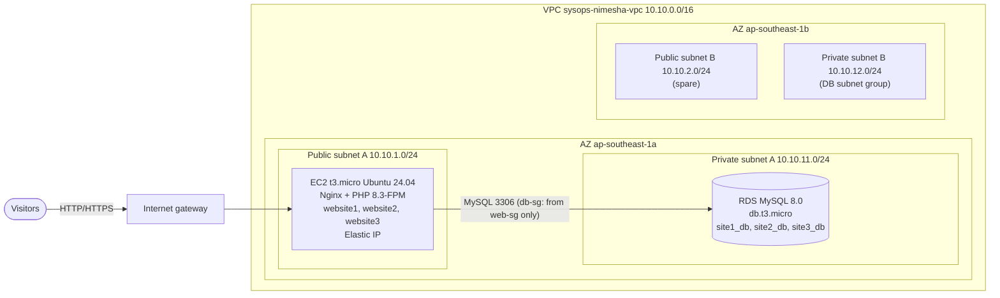

# Demo Video Plan: SysOps Practical Exam

Target length: **15 to 18 minutes**. Record the screen with your voice. Speak simply: say **what** you built, then **why**.

Everything is already built. The video only shows it and explains it. You don't need to run `terraform apply` on camera.

**Every command in this plan is labelled:**
- **LAPTOP** = run in Git Bash on your laptop, in the project folder.
- **SERVER** = run after you SSH into the EC2 server.

Copy and paste commands from this file. You don't need to remember any.

---

## 0. Command sheet: the ones you'll use first

### A. Open the project folder (LAPTOP, Git Bash)
```bash
cd ~/OneDrive/Desktop/SysOpsTest/SysopsTest
```

### B. Connect to the server (LAPTOP)
```bash
ssh -i Saberian_new.pem ubuntu@47.130.163.143
```
- The first time it may ask `Are you sure you want to continue connecting?` Type `yes`.
- You are on the server when the prompt shows `ubuntu@ip-10-10-1-158:~$`.
- To leave the server and return to your laptop: type `exit`.
- If it says `Connection timed out`, your IP has changed. See "If something goes wrong" at the end of this section.

### C. Open the websites in a browser with no DNS (LAPTOP, PowerShell)
```powershell
& "C:\Program Files\Google\Chrome\Application\chrome.exe" --host-resolver-rules="MAP *.saberion.cloud 47.130.163.143" --user-data-dir="$env:TEMP\demochrome"
```
In the Chrome window that opens, visit:
- http://website1.saberion.cloud
- http://website2.saberion.cloud
- http://website3.saberion.cloud

Use `http://`, not `https://`. HTTPS is not set up.

### D. Database address (used in many commands)
```
sysops-nimesha-db.ct0gkqqme0ya.ap-southeast-1.rds.amazonaws.com
```
To avoid retyping it, set a shortcut after you SSH in (SERVER). **Do this first, every time you connect**, because the shortcut is lost whenever you open a new SSH session or type `exit`:
```bash
DB=sysops-nimesha-db.ct0gkqqme0ya.ap-southeast-1.rds.amazonaws.com
echo $DB
```
`echo $DB` must print the endpoint. If it prints a blank line, the shortcut is not set.

**Make it permanent (SERVER, run once):** this saves the shortcut so every future SSH session has it already.
```bash
echo 'export DB=sysops-nimesha-db.ct0gkqqme0ya.ap-southeast-1.rds.amazonaws.com' >> ~/.bashrc
source ~/.bashrc
echo $DB
```
After this you only need `echo $DB` to confirm it. Do the one-time setup **before** recording.

**What a blank `$DB` looks like:** the command runs as `mysql -h -u ...`, which gives either `Unknown MySQL server host '-u'` or a long `Usage: mysql [OPTIONS]` help text. Both mean `$DB` is empty. Set it and run the command again.

**No shortcut? Paste the endpoint into the command instead:**
```bash
mysql --no-defaults -h sysops-nimesha-db.ct0gkqqme0ya.ap-southeast-1.rds.amazonaws.com -u site2_user -p site2_db -e "SHOW TABLES;"
```

### E. Passwords
- Every `mysql ... -p` command asks `Enter password:`. Type it. **Nothing appears on screen**, which is normal and keeps it hidden.
- Use `sysopsadmin` with the RDS master password. Use `site1_user`, `site2_user` and `site3_user` with each site's own password.
- Never type a password inside a command, so it can't appear on the video.

### F. Quick health check before recording (LAPTOP)
```bash
for n in 1 2 3; do curl -s -H "Host: website$n.saberion.cloud" http://47.130.163.143/ | grep -E "Connected" | sed 's/<[^>]*>//g'; done
```
You should see `Database: Connected` three times.

### If something goes wrong
| Problem | What to do |
|---|---|
| `ssh` says `Connection timed out` | Your public IP changed and `web-sg` allows only the old one. Find the new one with `curl -4 https://checkip.amazonaws.com`. In the AWS console go to EC2, Security groups, `sysops-nimesha-web-sg`, Edit inbound rules, and set SSH to the new IP with `/32`. Do this **before** recording |
| `Permission denied (publickey)` | Run `ssh -i Saberian_new.pem ubuntu@47.130.163.143` from the project folder, where the `.pem` file is |
| `UNPROTECTED PRIVATE KEY FILE` | Run `chmod 400 Saberian_new.pem`, then try again |
| Website shows nothing | You are not using the Chrome launch from step C, or you typed `https://` |
| `mysql: command not found` | You are on your laptop, not the server. SSH in first |
| `Unknown MySQL server host '-u'`, or a long `Usage: mysql [OPTIONS]` help text | `$DB` is empty. Run `DB=sysops-nimesha-db.ct0gkqqme0ya.ap-southeast-1.rds.amazonaws.com`, check with `echo $DB`, then rerun the command |
| `Access denied for user` | Wrong password for that user. `sysopsadmin` uses the RDS master password. `site1_user`, `site2_user` and `site3_user` each use their own password from that site's `config.php` |

---

## 1. Before you press record

### Set up (10 minutes)

| Item | What to do |
|---|---|
| Browser tabs, in this order | 1 EC2 console, 2 VPC console, 3 RDS console, 4 the three websites |
| AWS console | Region **ap-southeast-1** selected. Zoom the browser to about 125% so text is readable |
| VS Code | Project folder open, ready to show the Terraform files |
| Terminal 1 (LAPTOP) | Git Bash in the project folder (command A) |
| Terminal 2 (SERVER) | Connected with command B, then run command D |
| Websites | Opened with command C |
| Clean up first | Remove the old test row (below). Close notifications, chat and email |

**Remove the old "Test post" row from Website 1 (SERVER):**
```bash
mysql --no-defaults -h $DB -u site1_user -p site1_db -e "DELETE FROM news WHERE title='Test post';"
```

**Clear the screen before you start (SERVER and LAPTOP):**
```bash
clear
```

### Never show on camera
- Passwords: the RDS master password and the three site passwords.
- The `.pem` key contents, `terraform.tfvars` and `terraform.tfstate`.
- `config.php` contents with real passwords. Show only its permissions with `ls -l`.
- Your email, other AWS accounts or billing pages.
- If you set `TF_VAR_db_password` in the terminal for the Terraform step, do it **before** recording, then run `clear`.

### Dry run
Do one full run-through with no recording. Time it. Cut anything that waits more than 30 seconds.

---

## 2. Opening and architecture (about 2 minutes)

**Show:** the architecture diagram (from `README.md`, or an image from section 8).

**Say:**
> "I built a hosting platform on AWS in Singapore. One Ubuntu web server runs Nginx and PHP and hosts three websites. Each website has its own database on Amazon RDS. Only the web server is reachable from the internet. The database is in private subnets and accepts traffic from the web server alone."

Walk the diagram from left to right:
1. Visitors reach the **internet gateway**.
2. The **web server** sits in the public subnet.
3. The **database** sits in a private subnet with no route to the internet.
4. Security groups act as the firewalls between them.

**Why this design:** it is cheap (one small server, no NAT gateway, single-AZ database) and safe (the database cannot be reached from the internet).

---

## 3. Task by task

For each task: show the screen, run the command, say the reason.

### Task 1: Network (about 2 minutes)

**Show (VPC console):** VPCs, Subnets, Route tables, Internet gateways.

**Point out:**
- VPC `sysops-nimesha-vpc`, `10.10.0.0/16`, with DNS hostnames enabled. It is not the default VPC.
- Four subnets: public `10.10.1.0/24` and `10.10.2.0/24`, private `10.10.11.0/24` and `10.10.12.0/24`.
- Public route table: `0.0.0.0/0` to the internet gateway. Private route table: **local only**.
- No NAT gateway.

**Optional command, to show the same thing in text (LAPTOP):**
```bash
aws ec2 describe-subnets --region ap-southeast-1 --filters Name=vpc-id,Values=vpc-09177ed9ee9c7e5b3 --query "Subnets[].{Name:Tags[?Key=='Name']|[0].Value,Cidr:CidrBlock,AZ:AvailabilityZone,AutoPublicIp:MapPublicIpOnLaunch}" --output table
```

**Why:**
- A dedicated VPC keeps the project isolated.
- The private route table has no internet route, so the database can't reach or be reached from the internet.
- RDS needs subnets in **two** Availability Zones, which is why there are two private subnets. The second public subnet is spare for a future load balancer.
- No NAT gateway, because the exam forbids it and it costs money.

### Task 2: Security groups (about 1.5 minutes)

**Show (EC2, Security groups):** `sysops-nimesha-web-sg` and `sysops-nimesha-db-sg`, inbound rules.

**Point out:**
- Web: ports 80 and 443 from anywhere, port 22 only from my IP (`/32`).
- Database: port 3306 whose **source is the web security group**, not an IP range.

**Optional command (LAPTOP):**
```bash
aws ec2 describe-security-groups --region ap-southeast-1 --filters Name=group-name,Values='sysops-*' --query "SecurityGroups[].{Name:GroupName,Inbound:IpPermissions[].{Port:FromPort,Cidr:IpRanges[0].CidrIp,FromSG:UserIdGroupPairs[0].GroupId}}" --output json
```

**Why:**
- Only the ports a website needs are open.
- Referring to the security group means only the web server can reach the database, even if its IP changes.
- SSH from one IP stops the whole internet from trying to log in.

### Task 3: EC2 web server (about 2 minutes)

**Show (EC2 console):**
- Instance details: `t3.micro`, Ubuntu 24.04, public subnet A, the Elastic IP, IMDSv2 = **required**.
- Storage tab: 20 GiB `gp3`, **encrypted**.

**Then SSH in and run (command B, then SERVER):**
```bash
hostnamectl | grep -i "static hostname"
timedatectl | grep "Time zone"
```
Expected: `sysops-web01` and `Asia/Colombo`.

**Why:**
- The **Elastic IP** keeps the same public address after a reboot, so DNS stays valid.
- **Encryption** protects data on the disk.
- **IMDSv2** blocks a common attack that steals credentials from the instance metadata service.
- The `t3.micro` size is fixed by the exam and fits the cost goal.

### Task 4: Nginx and PHP (about 2 minutes)

**SERVER:**
```bash
nginx -v
php -v
systemctl is-enabled nginx php8.3-fpm
systemctl is-active nginx php8.3-fpm
sudo nginx -t
```
Then show the hardening (SERVER):
```bash
grep server_tokens /etc/nginx/nginx.conf
grep ^expose_php /etc/php/8.3/fpm/php.ini
```
Expected: `server_tokens off;` and `expose_php = Off`.

**Why:**
- **Nginx** serves web pages and is light on a small server. It can't run PHP itself, so it hands PHP files to **PHP-FPM** over a Unix socket (fast and local, nothing exposed on the network).
- "Enabled" means both start again after a reboot.
- Hiding the Nginx and PHP versions gives attackers less information.

### Task 5: RDS database (about 2 minutes)

**Show (RDS console):** the database `sysops-nimesha-db` details.

**Point out:** MySQL 8.0, `db.t3.micro`, **Single-AZ**, **Public access: No**, encrypted, security group `db-sg`, backup retention 1 day, deletion protection off, the two private subnets in the subnet group.

**Optional command (LAPTOP):**
```bash
aws rds describe-db-instances --region ap-southeast-1 --db-instance-identifier sysops-nimesha-db --query "DBInstances[0].{Id:DBInstanceIdentifier,Version:EngineVersion,Class:DBInstanceClass,MultiAZ:MultiAZ,Encrypted:StorageEncrypted,Public:PubliclyAccessible,BackupDays:BackupRetentionPeriod,DeletionProtection:DeletionProtection,Status:DBInstanceStatus}" --output json
```

**Why:**
- Public access **No** keeps the database off the internet.
- Single-AZ is cheaper, and the exam requires it.
- Backups protect against mistakes. Deletion protection is off only so the evaluator can remove the setup.

### Task 6: Databases and users (about 2.5 minutes)

**SERVER.** Run `echo $DB` first. It must print the endpoint (if blank, see command D). Type each password at the hidden prompt.

Show the three databases and three users (master account):
```bash
mysql -h $DB -u sysopsadmin -p -e "SHOW DATABASES; SELECT user,host FROM mysql.user WHERE user LIKE 'site%';"
```

Then the isolation proof, the key moment of this task:
```bash
mysql --no-defaults -h $DB -u site1_user -p -e "USE site1_db; SELECT 'site1_user can use site1_db' AS result;"
mysql --no-defaults -h $DB -u site1_user -p -e "USE site2_db"
```
The second one must print **Access denied**. Pause on it for two seconds.

**Why:** one database and one user per website means a problem in one site cannot read or damage another site's data. This is the principle of least privilege.

### Task 7: Nginx virtual hosts (about 2.5 minutes)

**SERVER:**
```bash
ls -l /etc/nginx/sites-enabled/
cat /etc/nginx/sites-available/website1.saberion.cloud
ls -l /var/log/nginx/ | grep website
ls -l /var/www/website*.saberion.cloud/config.php
```
`ls -l` on `config.php` must show `-rw-r----- root www-data`.

**Then the safety checks. Open a LAPTOP terminal (or type `exit` first):**
```bash
curl -i --max-time 5 http://47.130.163.143/
curl -s -o /dev/null -w "%{http_code}\n" -H "Host: website1.saberion.cloud" http://47.130.163.143/config.php
curl -sI -H "Host: website1.saberion.cloud" http://47.130.163.143/about.html | grep -i -E "^HTTP|^server|x-powered"
```
Expected:
1. `Empty reply from server`: the bare IP shows nothing.
2. `404`: `config.php` can't be downloaded.
3. `Server: nginx` with no version and no `X-Powered-By`.

**Why:**
- One server block per domain lets one server host three sites.
- The `public/` folder is the only thing served, and `config.php` sits above it, so nobody can download the database settings.
- `config.php` is `root:www-data` with mode `640`: the PHP process can read it and other users cannot.
- The default block returns `444` so the bare IP never exposes any of the sites.
- Separate logs make it easy to see which site has a problem.

### Task 8: The three websites (about 2.5 minutes)

**Show (the Chrome window from command C):** open each site in turn.
- Scroll to the footer and show **Connected**, the site name, the message from its own database, and the visit count.
- **Refresh** and show the count going up.
- Click the static **About** page and say "this page is plain HTML, Nginx serves it without PHP".
- On the shop: add two items to the cart, open the cart, check out with any name, email and address, and show the order confirmation.

**Then prove the data is in the database: the "before and after" demo (about 1.5 minutes)**

The idea: show the database table, change something on the website, run the **same query again**, and show the change. Keep the Chrome window and the SERVER terminal side by side.

Use one query for the whole demo. Type the password at the hidden prompt each time:
```bash
mysql --no-defaults -h $DB -u site2_user -p site2_db -e "SELECT 'CART' AS tbl; SELECT * FROM cart_items; SELECT 'ORDERS' AS tbl; SELECT id, customer_name, total FROM orders; SELECT 'VISITS' AS tbl; SELECT * FROM visits;"
```
(Press the up arrow to reuse it instead of retyping.)

| Step | Where | What to do | What to say |
|---|---|---|---|
| 1. Before | SERVER | Run the query above | "This is the database right now. The cart is empty." |
| 2. Add to cart | Browser (shop) | Click **Add to cart** on two products | "I'm adding two items." |
| 3. After | SERVER | Run the same query | "`cart_items` now has two rows. The cart is stored in the database, not in the browser." |
| 4. Change the cart | Browser | Open **Cart**, change a quantity, remove one item | "Changing the cart updates the row." |
| 5. After | SERVER | Run the same query | "The quantity changed and the removed row is gone." |
| 6. Checkout | Browser | Fill in name, email, address and place the order | "Now I place the order." |
| 7. After | SERVER | Run the same query | "A new row in `orders`, and the cart is now empty." |
| 8. Visits | Browser | Refresh the home page 2 or 3 times | "Each page load adds to the visit counter." |
| 9. After | SERVER | Run the same query | "The `visits` total went up." |

**Optional: prove it survives (the strongest point).**
Before checkout (step 3), close the shop tab, open a new tab in the **same** Chrome window, go to the shop's Cart page, and show the items are still there. (Don't relaunch Chrome with command C for this: a new Chrome profile has no session cookie, so it would start with an empty cart.) Then say: "The data lives in RDS, not on the web server and not in the browser, so it survives page reloads and even a web server restart."

If you have time, show that restarting the web server does not lose data (SERVER):
```bash
sudo systemctl restart php8.3-fpm nginx
mysql --no-defaults -h $DB -u site2_user -p site2_db -e "SELECT id, customer_name, total FROM orders;"
```
The orders are still there.

**The same idea for the other two sites (SERVER, optional, 20 seconds each):**
```bash
mysql --no-defaults -h $DB -u site1_user -p site1_db -e "SELECT * FROM visits;"
mysql --no-defaults -h $DB -u site3_user -p site3_db -e "SELECT * FROM visits;"
```
Refresh the site in the browser, run the query again, and the total goes up.

**Tips for this part:**
- Don't type the password inside the command. Type it at the hidden `Enter password:` prompt.
- Show the "before" result for at least two seconds so the viewer can read it.
- If a table looks wrong or a column name is different, run `SHOW TABLES;` and `DESCRIBE cart_items;` to see the real names, then adjust the query.
- Use the real order you placed during the demo. Don't insert rows by hand.

**To show all three visit counts at once (SERVER, master account):**
```bash
mysql -h $DB -u sysopsadmin -p -e "SELECT 'site1' AS site, total FROM site1_db.visits UNION ALL SELECT 'site2', total FROM site2_db.visits UNION ALL SELECT 'site3', total FROM site3_db.visits;"
```

**Why:** each page reads from and writes to its own database. The order you just placed appears in `site2_db`, which proves the whole chain works: browser, Nginx, PHP-FPM, RDS.

### Task 9: DNS and final checks (about 1 minute)

**LAPTOP:**
```bash
for n in 1 2 3; do curl -s -H "Host: website$n.saberion.cloud" http://47.130.163.143/ | grep -E "Connected|Visit count" | sed 's/<[^>]*>//g; s/^ *//'; done
```
You'll see `Connected` and a visit count for each of the three sites.

**Say:**
> "I don't have access to the saberion.cloud hosted zone in Route 53, so I tested using the Host header, as the exam describes. To go live, create three A records pointing to the Elastic IP 47.130.163.143. My Terraform code can also create them: set the hosted zone ID and apply."

---

## 4. Terraform (about 1.5 minutes)

**Show (VS Code):** the folder structure, then `main.tf`.

**Say:**
- "The network, security groups, EC2 and RDS are written as code in four modules: network, security, compute, database."
- "Every resource name starts with `sysops-nimesha-`, set from one variable. Tags `Project` and `Owner` are applied to everything through the provider's default tags."
- "The database password is never in a file. It comes from an environment variable."

**Why Terraform:** the setup can be rebuilt or removed with one command, and reviewed as text.

**Optional commands (LAPTOP, in the project folder).** Run the first two **before** recording, then `clear`:
```bash
export TF_VAR_db_password='<your RDS master password>'
terraform init
```
On camera:
```bash
terraform output
terraform plan
```
- `terraform output` shows the Elastic IP, VPC ID and database endpoint. It does not show the password.
- Run `terraform plan` on camera only if it ends with **"No changes"**. If it shows changes, skip it and don't mention it. The SSH rule may differ if your IP changed.

---

## 5. Problems and what you learned (about 1 minute)

Pick three from the work log:
1. **Security group wouldn't delete:** Terraform deleted the old group before moving the server to the new one. Fixed with `create_before_destroy`.
2. **No internet on the server:** Terraform removes the default outbound rule. Fixed by adding an outbound rule.
3. **RDS password rejected:** RDS does not allow `@`, `/`, `"` or spaces.

Showing that you found and fixed real problems makes a strong impression.

---

## 6. Closing (about 30 seconds)

> "To summarise: a private, encrypted database, one web server with three isolated sites, firewall rules that allow only what is needed, and everything built as code. Nothing is deleted, so you can review it. The optional items I did not do are HTTPS, SSM Session Manager and the CloudWatch alarm."

Finish by typing `exit` in the SERVER terminal, then stop recording.

---

## 7. Recording tips

- **Tool:** OBS Studio (free) or the Windows Game Bar (`Win + G`). Record at 1080p.
- **Font size:** increase the terminal font to 16-18 pt and zoom the browser. Viewers watch on small screens.
- **Pace:** slow down and pause for two seconds after each important output.
- **Cursor:** point at the line you are talking about.
- **Mistakes:** keep going. A short correction is fine. If it goes badly wrong, stop and record that section again, then join the clips.
- **Length:** under 20 minutes. Use chapter titles or a short text slide before each task.
- **Check the file:** play the video once to make sure no password or private detail appears.

### Quick checklist before you stop recording

- [ ] Architecture explained
- [ ] Tasks 1 to 9 each shown, with the reason said
- [ ] The `USE site2_db` failure shown
- [ ] A refresh that increases the visit count
- [ ] An order placed and found in the database
- [ ] No passwords visible

---

## 8. Architecture diagram: get one for the video

The exam says AI assistants are **not allowed unless the evaluator says otherwise**. Ask the evaluator first if you want to generate the diagram with AI. Options A and B need no AI.

### Option A: draw it yourself (recommended)

Use **diagrams.net (draw.io)**. In the AWS shape library, draw:

- A large box "AWS Region ap-southeast-1", with the VPC box `10.10.0.0/16` inside it.
- Two Availability Zone boxes (1a and 1b) side by side.
- Public subnet A with the EC2 icon, plus an Elastic IP; public subnet B empty.
- Private subnet A with the RDS icon; private subnet B empty.
- An Internet gateway on the VPC edge, with a "Visitors" icon outside pointing to it.
- Arrows: Visitors to Internet gateway, then to EC2, then EC2 to RDS labelled `MySQL 3306`.
- Labels: `web-sg: 80, 443 any / 22 my IP` and `db-sg: 3306 from web-sg only`.

### Option B: Mermaid (renders on GitHub or at mermaid.live)



To use it: open https://mermaid.live, paste the code between the fences, and export a PNG.

### Option C: AI prompt (only if the evaluator allows it)

Paste this into an image or diagram generator:

```text
Create a clean, professional AWS architecture diagram on a white background, landscape orientation, in the style of official AWS architecture diagrams with AWS service icons.

Left side: a "Visitors" icon (web browsers) with two arrows: one labelled "DNS lookup" going to a Route 53 icon labelled "saberion.cloud (A records website1, website2, website3)", and one labelled "HTTP / HTTPS" going to an Internet Gateway icon.

Centre: a large rounded box "AWS Region ap-southeast-1 (Singapore)". Inside it a box "VPC sysops-nimesha-vpc 10.10.0.0/16". Inside the VPC, two side-by-side columns: "Availability Zone ap-southeast-1a" and "Availability Zone ap-southeast-1b".

AZ 1a contains: a public subnet box "Public subnet A 10.10.1.0/24" with an EC2 icon labelled "EC2 t3.micro, Ubuntu 24.04, Nginx + PHP 8.3-FPM, vhosts website1 / website2 / website3, Elastic IP" and a small badge "web-sg: 80, 443 from anywhere, 22 from my IP"; below it a private subnet box "Private subnet A 10.10.11.0/24" with an RDS MySQL icon labelled "RDS MySQL 8.0 db.t3.micro, site1_db / site2_db / site3_db" and a badge "db-sg: 3306 from web-sg only". A vertical arrow from EC2 to RDS labelled "MySQL 3306".

AZ 1b contains two dashed, empty boxes: "Public subnet B 10.10.2.0/24 (spare for a future load balancer)" and "Private subnet B 10.10.12.0/24 (second AZ for the DB subnet group)".

Use blue for public subnets, green for private subnets, a lock icon on the private subnets, and label the route tables: public "0.0.0.0/0 to internet gateway", private "local only". Legible fonts, no shadows, minimal colours, no extra decoration.
```

If the result has a wrong CIDR or label, fix it by hand or regenerate. Check every number against the table in the README.

---

## 9. Time budget

| Part | Minutes |
|---|---|
| Opening and architecture | 2 |
| Tasks 1 to 3 | 5.5 |
| Tasks 4 to 6 | 6.5 |
| Tasks 7 to 9 | 6 |
| Terraform | 1.5 |
| Problems and closing | 1.5 |
| **Total** | **about 18-23, trim to 15-18** |

To shorten it: speak faster on Tasks 1 to 3 and skip the Terraform plan. Never cut the isolation proof, the Task 8 refresh, or the closing.
